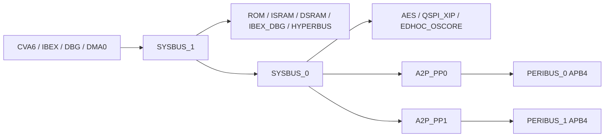

# FU3 bus — SystemC / TLM-2.0

Bus chức năng cho VP FU3, C++17 và SystemC 2.3.4. Phạm vi là routing,
arbitration, chuyển giao dịch tới ngoại vi, kiểm tra lỗi và policy cơ bản.
CPU, bộ nhớ, CSR và firmware loader thật do platform sở hữu; thư viện không
tạo IP giả. Fixture chỉ nằm trong `tests/`.

## Cấu trúc

```text
include/fu3_bus/       API public, config, router, A2P, access metadata
src/                  implementation và memory map FU3
tests/                behavior, config, contention; mọi executable dùng sc_main
tests/support/        master và sparse target giả cho test
tests/installed_consumer/  kiểm chứng find_package sau install
tests/coexist/         link cùng bus FX1, không sửa FX1
cmake/                package export
scripts/              build/test static + shared
docs/                 hợp đồng model và kết quả kiểm chứng
build/                output cục bộ, Git ignore
```

## Topology



Kết hợp Hình 4-1 và 7-1 của HAS v2.0: **cả hai A2P ở dưới SYSBUS_0**.
Giữ địa chỉ tr. 46–47; cột SYS của PERIBUS_1 trong bảng còn không nhất quán
với hình và được diễn giải theo topology đã thống nhất với người dùng.

`BusConfig::fu3()` có 4 initiator và 36 target enabled. Mọi target enabled
phải bind IP trước `sc_start`; initiator không dùng có thể để trống.
Platform có thể disable target chưa có IP; địa chỉ đó sẽ unmapped.
Không sửa cấu hình sau elaboration. Tên, range, overlap, width và path được
validate trước tạo module. Vùng địa chỉ dùng `[base, base+size)`.
Các tầng trung gian giữ global address; chỉ tầng leaf đổi sang local offset.
Địa chỉ và metadata payload được khôi phục sau transfer, kể cả exception.

## Tích hợp

```cpp
#include <fu3_bus/bus_system.h>
auto cfg = fu3_bus::BusConfig::fu3();
fu3_bus::BusSystem fabric{"fabric", cfg};
ibex.socket.bind(fabric.initiator("IBEX"));
cva6.socket.bind(fabric.initiator("CVA6"));
dma.socket.bind(fabric.initiator("DMA0"));
fabric.target("IBEX_ISRAM").bind(ibex_sram.socket);
fabric.target("SYSCSR").bind(syscsr.socket);
// Bind toàn bộ target enabled còn lại hoặc disable chúng trước khi tạo fabric.
// Boot controller gọi fabric.finish_staging() trước khi nhả reset CVA6.
```

Gọi `b_transport` từ `SC_THREAD`, không từ `SC_METHOD` hoặc trực tiếp trong
`sc_main`. Test/executable phải định nghĩa `int sc_main(int, char**)`; thư viện
không chứa `main`/`sc_main`. `tests/installed_consumer/main.cpp` là ví dụ chạy được.

Firmware loader dùng `transport_dbg` để ghi byte vào memory model trước hoặc
trong simulation mà không cộng thời gian. Đây là backdoor có chủ ý, bypass policy;
không được dùng thay đường CPU thường. Test nạp/readback một dãy byte trong ISRAM,
**chưa có CPU chạy firmware hoặc ELF loader** trong thư viện bus.

## CPU/DMA transaction contract

Default FU3 ports `CVA6`, `IBEX`, `DBG`, `DMA0` require `Access` on every
functional transaction. Missing metadata returns GENERIC_ERROR; the fabric never
silently guesses instruction/data or beat width. `transport_dbg` is for loaders.

```cpp
// tx already has command, global address, data, length and streaming_width >= length.
// DMA: five halfword FIFO beats, length = 10 bytes.
{
    fu3_bus::ScopedAccess request(tx, 2, fu3_bus::Burst::Fixed);
    dma.socket->b_transport(tx, delay);
}
// CPU instruction fetch: read, length=4, address aligned to four bytes.
{
    fu3_bus::ScopedAccess fetch(tx, 4, fu3_bus::Burst::Increment, true);
    cpu.socket->b_transport(tx, delay);
}
```

- Beat width is 1/2/4 bytes, naturally aligned; length must be a multiple of it.
  INCR advances the address; FIXED holds it while advancing data/byte-enable position.
- DMA accepts at most 16 beats. CPU/DBG have a configurable VP guard of 256 beats
  (`max_beats`), not a burst-length value established by the HAS. WRAP, atomics
  and streaming wrap are unsupported and must not be silently substituted.
- Check the entire footprint before the first beat. FIXED near an aperture end
  is valid when one beat fits. An INCR request crossing a target is rejected whole.
- `Burst` describes functional address progression, not AXI AxBURST encoding.
  Ingress emits single incrementing operations; fixed-address requests become
  repeated singles. DBG rejects fixed progression and non-word beat sizes.
- Word interfaces from Table 7-1 receive aligned 4-byte operations. Narrow accesses
  use lane enables and read extraction without RMW; other endpoints retain exact
  beat sizes. QSPI receives single operations with one outstanding maximum.
  Byte enables repeat over payload bytes and survive beat boundaries.
- No read-modify-write on CSR. Targets must honor byte enables. `Strobe = Full` is confirmed
  by the user to mean full byte-write-strobe support, including partial/sparse
  writes, not mandatory all-byte writes. IP adapters must satisfy this contract.
  Both PERIBUS_0 and PERIBUS_1 use APB4: the user requires matching versions,
  using the explicit APB4 version of PERIBUS_1 for both. This clarifies the PDF
  label on PERIBUS_0. Transfer-size adaptation remains a separate question.
- Downstream error stops the request; completed beats are not rolled back.
  Exceptions restore payload fields and release admission, order and pipeline leases.
- Custom initiators in `BusConfig{}` default to `require_access=false` for legacy
  TLM models. Without metadata they issue linear byte blocks, not AXI bursts;
  legacy A2P accepts aligned 1/2 bytes or word-aligned 4..64-byte blocks. Do not
  use this mode as a replacement for FU3 CPU/DMA instruction/transfer semantics.

## Admission, ordering and pipelines

- CPU admission is 2 total read/write requests; DBG is 1; DMA has separate 4-read
  and 4-write gates. Excess callers wait FIFO rather than fail. A slot spans the
  complete request, including time waiting for its ordered turn.
  The CPU combined limit is a conservative VP interpretation of Table 7-1, not
  an explicit per-direction limit. HyperBus/EDHOC target capacities default to
  one because their table entries are unspecified; see MODEL_CONTRACT.md for
  the PDF evidence and selected defaults.
- Requests sharing master, direction and `Access::ordering_id` remain ordered.
  Different ordering IDs can complete independently. ID zero is the default;
  adapters must use distinct IDs only where out-of-order completion is allowed.
  This is an ordering token, not a signal-level AXI ID implementation.
- Output dispatch is FIFO per beat, confirmed by the user; there is no fixed
  master priority. Arrival order is measured at each arbiter after input delay;
  simultaneous arrivals follow scheduler enqueue order. Independent outputs do
  not share a global completion-order constraint. One-stage APs at masters and AP_SB0 release
  before downstream completion; leaf occupancy is separately bounded. SRAM/AES
  allow four pending operations, ROM/QSPI one. Custom AXI target capacity is
  `TargetConfig::outstanding`; its default is one. APB always serializes.
- Slow IPs do not retain SYSBUS dispatch ownership. Independent outputs, including
  those behind AP_SB0, can overlap. A stalled IP can exhaust its target/master
  capacity; no timeout is invented. `peak_outstanding` reports admission peaks.
- AP_PP0/1 and A2P retain serialized APB access. Stage timing is a functional LT
  approximation, not a model of independent AXI channel handshakes or RTL throughput.
- Input and downstream delays are consumed once; return delay is zero. Defaults:
  AP 2 ns (`axi_cycle_ns`), PP 10 ns (`apb_cycle_ns`), router decode 2 ns
  (`router_latency_ns`), A2P setup+access two APB cycles per beat. These are VP
  parameters, not confirmed RTL frequencies. APB timing tests include all stages.
- Functional requests yield to the kernel. Validation/policy failures consume
  router latency so an error loop does not starve a time-scheduled peer. With
  all latencies zero, fairness is only among runnable processes; an infinite
  delta-cycle loop cannot advance physical time. DMI and `nb_transport` are disabled.

## Access, boot and reset

- ROM is readable only by IBEX and never functionally writable. DBG/DMA denial
  is a conservative documented choice pending a full permission matrix.
- DSRAM rejects instruction fetch. Default ports reject missing metadata; CPU
  adapters must still identify fetches honestly. This does not replace PMP/ePMP
  or the CPU's full W^X/cacheability implementation.
- IBEX may write CVA6_ISRAM during staging. Stop issuing IBEX requests and drain
  them before `finish_staging()` and CVA6 reset release. The call throws
  `std::logic_error` without changing policy if IBEX has any pending request.
- `reset()` requires all masters to be quiescent; otherwise it throws without
  changing policy. It reopens staging for reboot, does not reset external IPs or
  abort transactions, and retains diagnostic peak counters.
- Clock/reset pins, CGF, IRQ, HyperRAM readiness and peripheral CSR behavior are
  platform/IP responsibilities. The bus does not invent missing register maps.
- `transport_dbg` bypasses timing and access policy intentionally for firmware
  loading, but still rejects cross-window requests. It is not a CPU execution path.

| Condition | TLM response |
|---|---|
| Unmapped, cross-window, misalignment | ADDRESS_ERROR |
| Unsupported command, denied policy, instruction write | COMMAND_ERROR |
| Unsupported beat/count/burst/streaming | BURST_ERROR |
| Invalid byte enables | BYTE_ENABLE_ERROR |
| Missing required metadata, null data, zero length | GENERIC_ERROR |

## Build và kiểm thử

Linux/WSL, SystemC được build bằng compiler/ABI và chuẩn C++ tương thích:

```bash
SYSTEMC_HOME=/path/to/systemc-install bash scripts/build.sh
```

Script build bus static và shared, chạy regression, install rồi build/test một
consumer riêng qua `find_package(fu3-bus CONFIG REQUIRED)`. Cuối cùng build một
consumer link đồng thời FX1/FU3. Output chỉ trong `bus/build/`.

Windows PowerShell gọi WSL (SystemCHome là đường dẫn Linux):

```powershell
.\scripts\build.ps1 -SystemCHome /path/to/systemc-install
```

Build đơn:

```bash
cmake -S . -B build/local -DSYSTEMC_HOME=/path/to/systemc-install -DFU3_BUS_BUILD_TESTS=ON -DBUILD_SHARED_LIBS=ON
cmake --build build/local --parallel 4
ctest --test-dir build/local --output-on-failure
```

Public target là `fu3::bus_system`, public dependency `SystemC::systemc`. Dùng
imported target để giữ compile/link flags và dependencies của SystemC shared;
không hardcode `-lsystemc` hoặc tự cung cấp entry point thay kernel. Namespace,
header path, CMake target và package riêng biệt với FX1. Native Windows DLL có
export-all-symbols nhưng chưa được kiểm chứng; môi trường kiểm chứng là WSL/Linux.

Chi tiết map và các điểm chờ RTL: [MODEL_CONTRACT.md](docs/MODEL_CONTRACT.md).
Kết quả chạy thực tế: [VALIDATION.md](docs/VALIDATION.md).
Hướng dẫn review và tích hợp vào repo: [REPOSITORY_HANDOFF.md](docs/REPOSITORY_HANDOFF.md).
