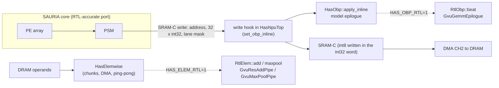

# Connecting GvuTop to the SAURIA core

This guide is for the owner of `has/rtl_ref_gvu_top.h` (`GvuTop`). It explains where the vector unit meets the SAURIA core
in the instruction path of `HasNpuTop`, which sockets already exist for it, what the core hands over, and how to plug
`GvuTop` in step by step without changing any default result of the model.

Scope: the three vector-unit operations YOLOv8m uses. They are the GEMM_FUSED epilogue (requantization and activation
table), the residual add and the max pool. Softmax, LayerNorm and FUSED_ATTN (ViT) come later and use the same method.

Labels used below:
- **read**: read from the code, with a file reference.
- **measured**: a number from a run.
- **proposal**: not decided; it needs the hardware team or the owner of `GvuTop`.

## 1. Where the vector unit sits today



**GEMM_FUSED epilogue** (read, `has/has_npu_top.h`, `set_obp_inline`):
- Every time the PSM writes SRAM-C, it calls a hook with the word address, the 32 int32 lanes and the lane mask, just
  before the data reaches the write port.
- The hook maps lane `k` of the word at address `a` to element `e = (a mod 1536) * 32 + k`. The output channel of the
  element is `e / npos`, where `npos` is the number of output positions of the tile.
- The hook cuts the vector into runs of lanes of the same channel and calls `HasObp::apply_inline` once per run. That
  call computes `requant` and then `lut_direct`. The int8 result is written into the same int32 word.
- The epilogue is only active on the last Cin part of a tile. Earlier parts keep the int32 partial sums so that the next
  part can accumulate.
- Timing: the result is in SRAM-C in the cycle of the PSM write. After `o_done` of each core pass, `core_end` waits
  8 cycles and then the epilogue tail (`HasObp::inline_latency()`): 10 cycles by default, or 9 with `HAS_OBP_RTL=1`.

**Per-channel parameters** (read, `inline_params`):
- The scale and shift of each output channel of the tile are set directly in `HasObp` with no bus cycles. The model
  assumes they already sit in the Scratchpad sbank, loaded by DMA behind the previous tile.
- The zero point and the activation table come from the layer instruction.
- The model loads the activation table over its host port (32 copies, 4,096 cycles per layer).

**ELEM_WISE** (read, `has/gvu_elemwise.h`):
- `HasElemwise` splits a tensor into chunks that fit the Scratchpad.
- DMA loads the operands of a chunk and the unit computes it; DMA then stores the result. DMA and compute run in
  ping-pong.
- Average pool and the separable max pool stay on the model.

## 2. The two sockets that already exist

Both sockets are off by default. With the variable unset, nothing computed by the model changes. When a socket is on,
the model computes its own result first and then runs the same data through a cycle-level unit. Every lane is compared
and the unit's value is the one written. A table is printed when the program exits.

| Socket | Knob | Called from | Unit behind it today | Interface |
|---|---|---|---|---|
| `has::RtlObp::beat` (`has/gvu_rtl_obp.h`) | `HAS_OBP_RTL=1` | `HasObp::apply_inline` (`has/gvu_obp.h`) | `GvuGemmEpilogue` (`has/rtl_ref_gvu_requant.h`, 9 cycles) | one beat: 32 int32 lanes, lane mask, scale, shift, zero point, rounding mode, activation on / off |
| `has::RtlElem::add`, `has::RtlElem::maxpool` (`has/gvu_rtl_elem.h`) | `HAS_ELEM_RTL=1` | `HasElemwise` (`has/gvu_elemwise.h`) | `GvuResAddPipe`, `GvuMaxPoolPipe` in an `ElemwiseBench` (`has/rtl_ref_gvu_elemwise.h`) | one chunk: operand arrays, quantization parameters; returns the values and the compute cycles of the chunk |

These sockets are where `GvuTop` plugs in. It becomes a third backend behind the same calls, so the core, the DMA, the
schedule and every test around them stay as they are.

Measured with both sockets on (package check, YOLOv8m instructions 86 to 88): PASS, 108,544 lanes, 0 differ from the
model.

## 3. What the core hands over (measured)

These numbers come from a probe at the SRAM-C port of the PSM (`HAS_PSM_PROBE=1`, `has/gvu_psm_probe.h`). They were
taken on YOLOv8m instructions 40 and 41 (Cin split, `PAD_TAIL`, tile widths 31 and 128) and on instructions 86 to 88.

| Question | Answer | Consequence for GvuTop |
|---|---|---|
| How often is a word written in one core pass? | twice; the two masks never overlap; some writes have an empty mask | a beat with an empty mask must pass through harmlessly |
| Does a write ever hold lanes of two output channels? | no, never, even when `npos` is not a multiple of 32 | one scale and one shift per beat is enough |
| Write rhythm | bursts of up to 64 beats, one per cycle, with more than 64 cycles between bursts | the epilogue must take one beat per cycle; no back-pressure is needed |
| Re-read of a written word in the same pass | yes, at least 64 cycles later | a delayed write of up to 9 cycles stays correct |
| Last write to `o_done` | always 4 cycles | a 9-stage tail ends at `o_done + 5`, inside the existing `wait(8)` |

## 4. GvuTop today and what each socket needs

What `GvuTop` does today (read, `has/rtl_ref_gvu_top.h` as merged):
- It runs GEMM_FUSED and the residual add on tiles. The data is preloaded into the Scratchpad:
  - GEMM_FUSED: psum in vbank2, activation table in vbank1 buffer 1, result written to vbank0.
  - Residual add: A in vbank0, B in vbank1, sum in vbank2, result in vbank0.
- There is no max pool state.
- These pipelines follow the MAS. The hardware RTL received so far has only the Softmax pipeline. The datasets under
  `target/test/gemm_fused` and `target/test/residual_add` come from `tools/gen_test_datasets.cpp`, not from the
  hardware team. That makes the comparison with the model in section 5 the first check by a second implementation.

Measured with the datasets of `GvuTop` and the model's own units (`GvuGemmEpilogue` through `RtlObp::beat`,
`GvuResAddPipe` through `RtlElem::add`), same parameters:

| Run | Differ from the `GvuTop` golden |
|---|---|
| Residual add, `target/test/residual_add` (tile, vec), round half up | 0 / 4,096 and 0 / 64 |
| GEMM_FUSED, `target/test/gemm_fused`, model with round half away (the mode `GvuTop` uses) | 0 / 4,096 and 0 / 64 |
| GEMM_FUSED, same data, model with round half up (the mode of the YOLOv8m program) | 76 / 4,096 and 2 / 64 |
| `tb_gvu_top_gemm_fused` on psums over the whole int32 range, golden from the model (round half away, int16 saturation) | 1,089 / 4,096 and 17 / 64 (expected 127, `GvuTop` gives -32: the wrapped value went through the table) |
| Same, psums whose scaled value stays inside int16 | 0 / 4,096 and 0 / 64 |

So the arithmetic of the two implementations was the same except for the rounding mode and the narrowing. The datasets
of `tools/gen_test_datasets.cpp` keep psums within plus or minus 200, so they do not reach either difference.

**Corrected in `has/rtl_ref_gvu_top.h`** (GEMM_FUSED path; Softmax, LayerNorm and the residual add untouched):

| Item | Before | Now |
|---|---|---|
| Rounding of the round-shift | fixed `RND_NEAR_AWAY` | input `i_gemm_round` (default `RND_NEAR_AWAY`, so the existing datasets keep their golden); `config_gemm_fused(..., round)` in the SystemC wrapper |
| Narrowing after the shift | `NARROW_WRAP` to 16 bits | `NARROW_SATURATE` to int16, as `GvuRequantPipe` and `has::requant` |
| Scale and shift source | sbank value if non-zero, else the scalar input | sbank when `i_gemm_per_channel`, else the scalar input |
| Activation table | loaded once after reset | input `i_gemm_lut_reload`: held with `i_pipeline_en` until the controller is in `LUT_ACT_INIT`, it loads the table of vbank1 buffer 1 again |

Checks after the correction (measured):

| Check | Result |
|---|---|
| `tools/has/tb_gvu_top_vs_model.cpp`, 12 GEMM_FUSED runs one after the other with a new table each (reload), 12 residual-add runs; random scales, shifts, zero points, all seven rounding modes, psums up to the full int32 range | 24 / 24 runs, every element equal to the model's units |
| Same test with the old narrowing put back | 2 of 12 GEMM runs differ; with the old fixed rounding, 9 of 12 differ: the test sees both faults |
| `tb_gvu_top_gemm_fused` on psums over the whole int32 range | 0 / 4,096 and 0 / 64 (before: 1,089 and 17) |
| The six runs of `tb_gvu_top`, `tb_gvu_top_gemm_fused`, `tb_gvu_top_residual_add` (tile, vec), both build modes, and `tb_gvu_top_layernorm` | unchanged: same cycles, 0 mismatches |

Still open (read in both files):

| Item | `GvuTop` GEMM_FUSED | Model epilogue (`has::requant`, `GvuGemmEpilogue`) | What to do |
|---|---|---|---|
| Per-channel parameters | read from sbank when `i_gemm_per_channel`; not covered by any test yet | one scale and one shift per beat (the core never mixes channels in a beat) | decide how the socket gives them (question 2) and add a test |
| Zero point | `int8_t` | 16 bits, wrapping adder | enough for int8 tensors; widen only if an int16 output is needed |
| Beat input | vbank2 preload, or `i_psum_vec` with `i_psum_valid` (lane 0 also from `i_psum_data` when lane 0 is 0) | one beat per cycle from the PSM | use only the `i_psum_vec` stream for the socket; drop the lane-0 substitution |
| Depth | combinational inside one `eval` (about 2 cycles from beat to vbank0 per the tile runs) | 9 cycles from the register cuts of the drawing and the measured latencies of the units (multiplier 4) | report the depth that `GvuTop` implements; the socket measures it per beat |
| Output | vbank0 write, also `o_gemm_fused_valid` / `o_gemm_fused_data` | int8 value per lane, written back into SRAM-C | the socket reads `o_gemm_fused_data` |
| Max pool | no state | `GvuMaxPoolPipe` | question 4 |

## 5. Steps, each with a check

Each step is behind a knob that is off by default. Every step ends with the regression still passing with the knob off.

| Step | Work | Check (prediction written before the run) |
|---|---|---|
| 1 | Standalone equivalence. A new test bench drives `GvuTop` and our units with the same data. Inputs: the beats of `tools/has/tb_rtl_ref_gvu_requant.cpp` (directed, quantized and full-range sets), and the ELEM_WISE instructions of the YOLOv8m program that `tools/has/tb_rtl_ref_gvu_replay.cpp` replays (`fe_work/has/insts_pe3`). | every lane equal; cycles reported, not required to be equal. Done on random data by `tools/has/tb_gvu_top_vs_model.cpp` (section 4); still to do: per-channel parameters and the real data of the YOLOv8m program |
| 2 | Adapter `has/gvu_top_bridge.h` (new file, owned by the `GvuTop` owner). It has the same signatures as `RtlObp::beat` and `RtlElem::add`, but runs `GvuTop`. Knob `HAS_GVU_TOP=1`. The two call sites in `has/gvu_obp.h` and `has/gvu_elemwise.h` are a one-line branch each; the model side makes that edit on request. | build in both configurations (below); regression with the knob off unchanged. Done on the model side, section 9 |
| 3 | Short runs through the core: `tools/has/tb_has_npu_top fe_work/has/insts_pe3 --first 86 --count 3` with `HAS_GVU_TOP=1`, then window D (`--first 40 --count 2`, reference 1,658,986 cycles). | `RESULT: PASS`, 0 lanes differ, cycle change explained by the depth. Done, section 9.3 |
| 4 | Whole YOLOv8m, overnight, only after step 3 passes. | PASS; cycle total within a predicted band |
| 5 | Later: a clocked connection (the beat enters `GvuTop` on the core clock and the write lands after the real depth). This needs the hardware answer on the PE-to-GVU interface (ready / back-pressure). | not planned yet |

Build configurations that must compile for any change under `has/`:

```bash
g++ -std=c++17 -O2 -DSAURIA_DEBUG=0 -DSAURIA_CORE_BACKEND_RTL_REF -DFX1_A3_SRAM_BACKDOOR_LOAD -DFX1_NO_PERF -I. -I/usr/include \
    tools/has/tb_has_npu_top.cpp -lsystemc -lm -pthread -o tb_has_npu_top
g++ -std=c++17 -O2 -DSAURIA_DEBUG=0 -DSAURIA_CORE_BACKEND_RTL_REF -DFX1_A3_SRAM_BACKDOOR_LOAD -DFE_METRICS -I. -I/usr/include \
    tools/has/tb_has_npu_top.cpp -lsystemc -lm -pthread -o tb_has_npu_top_metrics
```

A new header under `has/` also needs `python3 tools/has/make_core_rtl.py --check`. The company wrapper includes
`has/` through the forwarding headers in `core_rtl/`.

## 6. Tests to keep green

| Test | Command | Expected |
|---|---|---|
| GVU unit regression | `tools/has/regress_gvu.sh <out dir>` | every item PASS |
| Requant pipeline and epilogue | `g++ -std=c++17 -O2 -Wall -I. tools/has/tb_rtl_ref_gvu_requant.cpp -o t && ./t` | `RESULT: PASS`, depths 8 and 9 |
| Max pool and residual add pipelines | same pattern with `tools/has/tb_rtl_ref_gvu_elemwise.cpp` | `RESULT: PASS` |
| ELEM_WISE replay of YOLOv8m | `tools/has/tb_rtl_ref_gvu_replay fe_work/has/insts_pe3` | every instruction equal to the reference image |
| Both sockets on, three convolutions | `HAS_ELEM_RTL=1 HAS_OBP_RTL=1 tools/has/tb_has_npu_top fe_work/has/insts_pe3 --first 86 --count 3` | PASS, `lanes 108544 | differ from the model 0` |
| GvuTop test benches | `tb_gvu_top`, `tb_gvu_top_gemm_fused`, `tb_gvu_top_residual_add`, each with `tile` and `vec`; `tb_gvu_top_layernorm` | `RESULT: PASS` |
| GvuTop against the model's units | `g++ -std=c++17 -O2 -Wall -I. tools/has/tb_gvu_top_vs_model.cpp -o t && ./t 12 1` (also an item of `regress_gvu.sh`) | `RESULT: PASS`, 24 runs |

## 7. Repository rules

- Branch from the current `main` (`git fetch`, then `git switch -c vuong/<topic> origin/main`). `main` only receives
  releases that passed the package check.
- No build products in git: no test-bench binaries, no `scratch/` executables. Log files go under `tools/logs/` only if
  a document quotes them.
- No absolute paths of one machine in sources or documents. Test benches take the dataset directory relative to the
  repository root, or from an argument.
- The six group A headers are frozen against the hardware RTL: `rtl_ref_gvu_fu.h`, `rtl_ref_gvu_lut.h`,
  `rtl_ref_gvu_vrf.h`, `rtl_ref_gvu_vlsu.h`, `rtl_ref_gvu_scratchpad.h` and `rtl_ref_gvu_ctrl.h`. Their hashes are in
  `tools/has/gvu_oracle/frozen_headers.sha256`. A change to one of them must be re-checked against the RTL simulation
  (`bash tools/has/gvu_oracle/run_all.sh <rtl gvu dir> <work dir>`, every block without a mismatch), and the hash list
  must be updated. Ask the model side for helpers you need
  there; do not change them in a local copy. The two helpers `GvuTop` calls are already in the frozen versions:
  `LutUnit::o_pipe_almost_done(mode)` and `GvuScratchpad::reset_addr_delays()`. The RTL trace check still passes with
  them.
- `has/has_npu_top.h`, `has/gvu_obp.h`, `has/gvu_elemwise.h` and the `has/gvu_rtl_*.h` sockets are changed by the model
  side. Propose the change; it is applied with the regression and the package check.
- After `git stash pop` or a merge, search for conflict markers before committing (`git grep -n '^<<<<<<<\|^>>>>>>>'`).

## 8. Questions for the owner of GvuTop

1. Will GEMM_FUSED take the beat stream (`i_psum_vec` with `i_psum_valid`, one beat per cycle) as its main input? The
   core cannot preload a whole tile into vbank2 before the epilogue.
2. Per-channel parameters: one scale and one shift per beat, given with the beat (the core never mixes channels in a
   beat, section 3), or read from sbank by a channel index?
3. Which depth does the GEMM_FUSED path of `GvuTop` implement, and on which drawing is it based?
4. Max pool: a new state in the controller, or should the socket keep `GvuMaxPoolPipe` for it?
5. Are the residual-add shifts and zero points meant to be 8 bits, or should they follow `GvuResAddPipe` (6-bit shift,
   16-bit zero point)?
6. `GvuTop` clears the delayed part selects of the Scratchpad (`reset_addr_delays()`) at every change of the controller
   state. The Scratchpad RTL has no such input. Which RTL behaviour does this stand for? If a narrow read is still in
   flight when the state changes, its data is sliced with part 0.

## 9. Connection made on the model side (stream mode and socket)

The model side made the changes of section 5, steps 1 to 3, itself. Each one is behind an input or a knob that is off by
default: with the knob unset, the model computes what it computed before, and the six `GvuTop` test benches keep their
results and cycles.

### 9.1 Changes in `has/rtl_ref_gvu_top.h`

| Item | What changed | Default |
|---|---|---|
| GEMM_FUSED stream mode | new input `i_gemm_stream`. In `GEMM_FUSED_ST1` the mode takes one beat per cycle on `i_psum_valid` + `i_psum_vec`, with gaps allowed; counts no tokens; does not read vbank2 or the sbank; does not write vbank0. `i_gemm_stream_stop` returns the controller to `IDLE` once the pipeline is empty | off: the tile mode is unchanged |
| Beat side data | inputs `i_psum_addr`, `i_psum_mask` (carried through the pipeline to `o_gemm_fused_addr`, `o_gemm_fused_mask`), `i_psum_scale`, `i_psum_shift` (Out_Scale / Out_Shift of the beat's output channel), `i_gemm_zp16` (16-bit zero point); output `o_gemm_fused_busy` | used only in stream mode |
| Stream depth | 9 cycles, the register cuts of the MAS Requant and GEMM_FUSED drawings: multiplier 32x32 4 + v32int64 register 1, round-shift with int16 saturation 1 + v32int16 register 1, add zero point (16 bits, wraps) + v32int16 register 1, clamp to int8 + v32int8 register 1, LUT_act 0. The shift travels with its beat; the zero point, the rounding mode and `i_gemm_skip_act` are held while beats are in flight | stream mode only; the tile mode stays combinational |
| Lane 0 substitution | not used in stream mode (`i_psum_data` is ignored there) | tile mode unchanged |
| Empty lane mask | the beat passes and leaves with an empty mask; the socket writes nothing for it | stream mode |
| Residual add, partial last row | new input `i_res_last_lane_mask`: lanes written in the last row of a run (last tile, last token) by both stages; the other lanes of that row keep their contents | all lanes |

Not changed: Softmax, LayerNorm, the tile modes of GEMM_FUSED and the residual add, the SystemC wrapper (the new inputs
keep their defaults there), the frozen group A headers.

### 9.2 The socket `has/gvu_top_bridge.h`, knob `HAS_GVU_TOP`

| Value | GEMM_FUSED epilogue | Residual add | Max pool | Activation table cycles |
|---|---|---|---|---|
| unset / 0 | model (or `HAS_OBP_RTL`) | model (or `HAS_ELEM_RTL`) | model (or `HAS_ELEM_RTL`) | 32 copies over the host port, 4,096 cycles per layer |
| 1 | every PSM write beat runs through `GvuTop` in stream mode, one beat at a time inside the write hook; the table is loaded through vbank1 rows 0 and 1 and `LUT_ACT_INIT`; tail behind a core pass = 9 | every chunk on `GvuTop` in runs of at most 128 rows, last row masked; compute cycles from `GvuTop` | `GvuMaxPoolPipe` (no max pool state in `GvuTop`) | as unset |
| 2 | as 1 | as 1 | as 1 | DMA of 256 bytes into vbank1 plus the controller through `LUT_ACT_INIT` |

`HAS_GVU_TOP` wins over `HAS_OBP_RTL` and `HAS_ELEM_RTL`. One `GvuTop` serves both instructions. Values outside the
containers of `GvuTop` keep the model result and are counted as "not expressible", for example a residual-add zero point
outside 8 bits. A table is printed at exit (`[gvu-top] ...`).

Call sites (one branch each): `HasObp::apply_inline` and `inline_latency` (`has/gvu_obp.h`), `HasElemwise::add` and
`maxpool` (`has/gvu_elemwise.h`), the table load in `exec_gemm` (`has/has_npu_top.h`, value 2 only).

### 9.3 Checks (measured)

| Check | Result |
|---|---|
| `tools/has/tb_gvu_top_vs_model.cpp 12 1` | 51 / 51 runs. The 24 tile-mode runs give the same output as before. 12 stream runs of 400 beats each in bursts of 1 to 64 with gaps up to 100 cycles; every beat has its own scale and shift and a random lane mask, empty masks included; one run in five has no activation, one in four keeps its table after a residual add. Result: every masked lane equal to `GvuGemmEpilogue`, every beat out after exactly 9 cycles with its address and mask, nothing out in a gap, stop back to `IDLE`. 12 residual adds of 1 to 4,096 elements: equal to `GvuResAddPipe`, masked lanes untouched. 3 residual adds on the shared unit between stream runs |
| Same test with the last-row mask removed / with one multiplier register removed | 12 runs fail each time (the partial-row adds / every stream run on its depth): the test sees both faults |
| The six `GvuTop` test benches (tile, vec; SystemC and plain C++), `tb_gvu_top_layernorm`, `tools/trace_gvu_top.cpp` | unchanged: 432 / 223, 144 / 77, 274 / 140 cycles (SystemC 428 / 219, 140 / 73, 270 / 136), LayerNorm 10,480 ns, 0 mismatches |
| `tools/has/tb_rtl_ref_gvu_replay.cpp --gvu-top`: every ELEM_WISE instruction of YOLOv8m and of ViT-B/16, residual adds through the socket | YOLOv8m 12 adds (6,374,400 elements) and 3 max pools, ViT-B/16 25 adds (3,782,400 elements): 0 bytes differ from the reference image, 0 not expressible. Compute cycles of `GvuTop`: 407,748 (YOLOv8m) and 241,950 (ViT-B/16), against 432,676 and 256,750 for `GvuResAddPipe`, i.e. 16 cycles less per run of up to 128 rows |
| `tb_rtl_ref_gvu_requant`, `tb_rtl_ref_gvu_elemwise`, frozen header list, both builds of `tb_has_npu_top` | PASS, 6 / 6 hashes, 0 warnings |

In-core runs, program `fe_work/has/insts_pe3` of YOLOv8m, default build of `tools/has/tb_has_npu_top` (measured):

| Run | Result |
|---|---|
| Instructions 86-88 (`--first 86 --count 3`, two SiLU layers), knobs off | PASS 3 / 3, 280,003 cycles |
| Same, `HAS_OBP_RTL=1` | PASS, 280,003 cycles; 3,392 beats, 108,544 lanes, 0 differ from the model |
| Same, `HAS_GVU_TOP=1` | PASS, 280,003 cycles (unchanged); 3,392 beats, 108,544 lanes, 0 differ, every beat at depth 9 with its address and mask |
| Same, `HAS_GVU_TOP=2` | PASS, 271,829 cycles: 8,174 fewer = 2 tables x (4,096 - 9); the 9 cycles of a table are the DMA estimate of 256 bytes (4 with the default DRAM latency of the run) plus 5 cycles from `IDLE` through `LUT_ACT_INIT` |
| Window D (`--first 40 --count 2`), `HAS_OBP_RTL=1` | PASS, 1,658,651 cycles; 596,736 lanes, 0 differ |
| Window D, `HAS_GVU_TOP=1` | PASS, 1,658,651 cycles; 596,736 lanes, 0 differ |
| Window D, `HAS_GVU_TOP=2` | PASS, 1,650,477 cycles (8,174 fewer, as above) |
| Replay outside the core (`tools/has/tb_gvu_top_replay.cpp`) of the beats recorded with `HAS_OBP_RTL=1 HAS_OBP_DUMP=<file>` | 86-88: 3,392 beats; window D: 29,808 beats. Back to back and one at a time: 0 lanes differ, latency 9 on every beat, 0 address / mask errors, 0 beats out of nothing |
| Speed | window D 842 s with `HAS_GVU_TOP=1` against 836 s with `HAS_OBP_RTL=1` (+0.7 %) |

The regression `tools/has/regress_gvu.sh` holds the short form of these checks: the 51 runs of
`tb_gvu_top_vs_model`, instructions 86-88 with `HAS_OBP_RTL=1` plus the replay of its beats, with `HAS_GVU_TOP=1` and
`=2`, and the residual adds of YOLOv8m replayed on `GvuTop`.

### 9.4 Still open

| Item | Status |
|---|---|
| Per-channel parameters from the sbank (MAS layout) | the stream mode takes them with the beat; the tile mode still reads the sbank by cycle count since the state was entered, with both sbank ports starting at address 0 (scale and shift overlap): not usable as written |
| Max pool | `GvuMaxPoolPipe` behind the socket (question 4) |
| Clocked connection (beat on the core clock, write after the real depth) | needs the hardware answer on the PE-to-GVU interface |
| Whole YOLOv8m with `HAS_GVU_TOP` | not run yet (step 4) |
