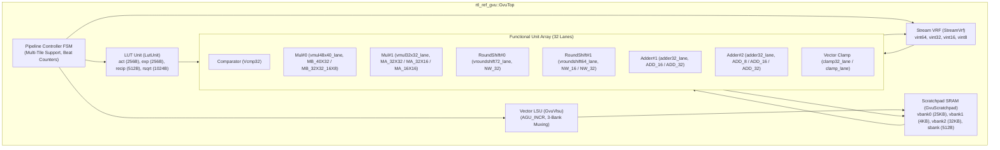

# Comprehensive Verification Report: GVU Top-Level Model (`rtl_ref_gvu_top`)

**Project**: Sauria NPU Generic Vector Unit (GVU) Top-Level Model  
**Module**: [`has/rtl_ref_gvu_top.h`](../has/rtl_ref_gvu_top.h)  
**Micro-Architecture Specification Reference**: MAS §5.2.1, §5.2.2, §5.2.3, §5.2.6  
**Verification Date**: October 2026  
**Status**: **ALL TEST SUITES PASSING (100% Bit-Exact Functional & Timing Conformance)**

---

## 1. Executive Summary

This report documents the verification status, execution sequences, cycle-accurate timing measurements, and bit-exact functional validation results for the top-level Generic Vector Unit model ([`rtl_ref_gvu_top.h`](../has/rtl_ref_gvu_top.h)).

All three GVU top-level testbenches (**Softmax**, **Element-Wise Residual Add**, and **GEMM Fused Requantization + Activation**) use the unified dataset-driven verification methodology matching `tb_gvu_top.sv`:
- Supporting both **`tile` mode** (`64 tokens × 64 token_len = 4,096 elements` across `2 tiles × 32 lanes`) and **`vec` mode** (`1 token × 64 token_len = 64 elements` across `1 tile × 1 lane`).
- Loading input files, LUT files (when applicable), and golden output files from `target/test/{softmax,residual_add,gemm_fused}/{tile,vec}/`.
- Preloading Scratchpad SRAM banks (`vbank0`, `vbank1`, `vbank2`), running cycle-accurate simulation, and comparing **100% of Scratchpad memory contents** against the golden reference files.

### 1.1 Test Suite Summary & Pass Rate

| Testbench Suite | Target Pipeline / Opcode | Dataset Directory | Modes (`vec` / `tile`) | Completion Cycle (`vec` / `tile`) | Functional Status | Memory Bit-Accuracy |
|---|---|---|---|---|---|---|
| [`tb_gvu_top.cpp`](../tb_gvu_top.cpp) | **Softmax Pipeline** (`GVU_OP_SOFTMAX`) | `target/test/softmax/{tile,vec}/` | 64 (vec) / 4,096 (tile) | **Cycle 223 / 432** (2,230 / 4,320 ns) | **PASS (0 mismatches)** | **100% Bit-Exact** (`vbank0` vs `golden_output.txt`) |
| [`tb_gvu_top_residual_add.cpp`](../tb_gvu_top_residual_add.cpp) | **Element-Wise Residual Add** (`GVU_OP_RESIDUAL`) | `target/test/residual_add/{tile,vec}/` | 64 (vec) / 4,096 (tile) | **Cycle 140 / 274** (1,400 / 2,740 ns) | **PASS (0 mismatches)** | **100% Bit-Exact** (`vbank2` vs `golden_sum.txt` & `vbank0` vs `golden_output.txt`) |
| [`tb_gvu_top_gemm_fused.cpp`](../tb_gvu_top_gemm_fused.cpp) | **GEMM Fused Requant + Act** (`GVU_OP_GEMM_FUSED`) | `target/test/gemm_fused/{tile,vec}/` | 64 (vec) / 4,096 (tile) | **Cycle 77 / 144** (770 / 1,440 ns) | **PASS (0 mismatches)** | **100% Bit-Exact** (`vbank0` vs `golden_output.txt`) |
| [`tools/trace_gvu_top.cpp`](../tools/trace_gvu_top.cpp) | **Trace Tool** (`softmax`, `gemm_fused`, `residual`) | N/A | 128 tokens | Verified per mode | **PASS (All Modes)** | Cycle-by-cycle SRAM & VRF bus state dumps verified |

> [!NOTE]
> **Key Verification Achievement**:
> - **`tb_gvu_top`**: **PASS (0 mismatches)** in both `tile` (4,096/4,096 elements) and `vec` (64/64 elements) modes using `lut_recip.txt`, `lut_exp.txt`, `input.txt`, and `golden_output.txt`.
> - **`tb_gvu_top_residual_add`**: **PASS (0 mismatches)** in both `tile` (4,096/4,096 elements) and `vec` (64/64 elements) modes using `input_a.txt`, `input_b.txt`, `golden_sum.txt` (Stage 1 `vbank2`), and `golden_output.txt` (Stage 2 `vbank0`).
> - **`tb_gvu_top_gemm_fused`**: **PASS (0 mismatches)** in both `tile` (4,096/4,096 elements) and `vec` (64/64 elements) modes using `lut_act.txt`, `input.txt` (`vbank2` int32 psum), and `golden_output.txt` (`vbank0` int8 output).

---

## 2. Model Architecture & Dual-Use Testbench Design

### 2.1 Top-Level Structural Integration



### 2.2 Dual-Use Execution Architecture
Every testbench is engineered with a dual-use wrapper allowing seamless execution across two target runtime environments:
1. **SystemC Simulation Mode (`<systemc.h>`)**:
   - Instantiates `ScGvuTop` wrapped as a native `sc_module`.
   - Generates clock via `sc_clock` (100 MHz, 10.0 ns cycle period).
   - Coordinates stimulus, monitor, cycle counting, and timeout watchdogs using dedicated `SC_THREAD`s and `sc_signal` channels.
2. **Standalone C++17 Cycle-Accurate Mode**:
   - Executes directly on `GvuTop` when compiled without SystemC libraries.
   - Emulates clock edges cycle-by-cycle via `dut.tick(in, rstn)`.
   - Enforces identical clock cycle latency, stimulus timing, output assertion checks, and 20,000-cycle watchdog protection.

---

## 3. Detailed Test Run Analysis

### 3.1 Test Suite 1: Element-Wise Residual Add (`tb_gvu_top_residual_add.cpp`)

#### Objective & Specification Reference
Validates the complete 2-stage element-wise tensor addition pipeline ($Y = \text{Requant}(\text{Dequant}(A) + \text{Dequant}(B))$) conforming to **MAS §5.2.6**, Figure 5-7, Figure 5-18, Table 5-2, Table 5-4, and Table 5-5.

#### Dataset Files (`target/test/residual_add/{tile,vec}/`)
- `input_a.txt`: `int8` input tensor A preloaded into `vbank0` buffer 0 (`sram(0, 0)`), row `k * token_len + i`, lane `j`.
- `input_b.txt`: `int8` input tensor B preloaded into `vbank1` buffer 0 (`sram(1, 0)`), packed 4 vectors per 128-byte SRAM line (`line = r / 4`, `quarter = r % 4`).
- `golden_sum.txt`: Golden Stage 1 `int32` intermediate sum verified against `vbank2` buffer 0 (`sram(2, 0)`).
- `golden_output.txt`: Golden Stage 2 `int8` final output verified against `vbank0` buffer 0 (`sram(0, 0)`).

#### Configuration Parameters
- `tile` mode: `num_token = 64, token_len = 64, num_tile = 2, tile_lane = 32` (4,096 elements)
- `vec` mode: `num_token = 1, token_len = 64, num_tile = 1, tile_lane = 1` (64 elements)
- Tensor A Quantization: $M_{0,A} = 192$, $TS_A = 8$, $ZP_A = -4$
- Tensor B Quantization: $M_{0,B} = 128$, $TS_B = 8$, $ZP_B = +2$
- Output Quantization: $M_{0,\text{out}} = 256$, $TS_{\text{out}} = 9$, $ZP_{\text{out}} = +5$, `RND_NEAR_UP`

#### Measured Execution Log (`tile` mode - 4,096 elements across 2 tiles × 32 lanes)
```text
[tb_gvu_top_residual_add] Running in standalone C++17 cycle-accurate mode (RESIDUAL_ADD).
Seed: 0
[tb_gvu_top_residual_add] Loading dataset from: target/test/residual_add/tile/
[tb_gvu_top_residual_add] Successfully loaded 64 tokens (4096 elements), 2 tiles (32 lanes/tile).
[tb_gvu_top_residual_add] Stimulus enabled at cycle 6 (60 ns): mode=tile token_len=64 num_tile=2 scale_a=192 shift_a=8 zp_a=-4 scale_b=128 shift_b=8 zp_b=2 scale_out=256 shift_out=9 zp_out=5
[tb_gvu_top_residual_add] Cycle     7 (    70 ns) State: IDLE            | Tile 0 start_d=0   end_d=0  
  --> Stage IDLE completed after 1 cycles (10 ns)
[tb_gvu_top_residual_add] Cycle 8     (80     ns) State: RESIDUAL_ST1    | Tile 0 start_d=1   end_d=0  
  --> Stage RESIDUAL_ST1 completed after 66 cycles (660 ns)
      [ST1 Check] vbank2[0] Lane 0 int32 sum: -158
[tb_gvu_top_residual_add] Cycle 74    (740    ns) State: RESIDUAL_ST2    | Tile 0 start_d=1   end_d=0  
  --> Stage RESIDUAL_ST2 completed after 67 cycles (670 ns)
[tb_gvu_top_residual_add] Cycle 141   (1410   ns) State: IDLE            | Tile 1 start_d=0   end_d=0  
  --> Stage IDLE completed after 1 cycles (10 ns)
[tb_gvu_top_residual_add] Cycle 142   (1420   ns) State: RESIDUAL_ST1    | Tile 1 start_d=1   end_d=0  
  --> Stage RESIDUAL_ST1 completed after 66 cycles (660 ns)
      [ST1 Check] vbank2[0] Lane 0 int32 sum: -158
[tb_gvu_top_residual_add] Cycle 208   (2080   ns) State: RESIDUAL_ST2    | Tile 1 start_d=1   end_d=0  

[tb_gvu_top_residual_add] o_residual_pipe_done asserted at 2740 ns (cycle 274)
  --> Stage RESIDUAL_ST2 completed after 67 cycles (670 ns)
[tb_gvu_top_residual_add] Cycle 275   (2750   ns) State: IDLE            | Tile 0 start_d=0   end_d=0  
Simulation end!

[tb_gvu_top_residual_add] ==================== VERIFICATION RESULTS ====================
[tb_gvu_top_residual_add] Comparing 100% of vbank2 (Stage 1 sum) and vbank0 (Stage 2 output) against golden files...

[tb_gvu_top_residual_add] Sample Output Comparison (First 8 positions for Lanes 0..3):
  Pos | Lane 0 (Exp/Act) | Lane 1 (Exp/Act) | Lane 2 (Exp/Act) | Lane 3 (Exp/Act)
  ----+------------------+------------------+------------------+------------------
  0   | -74  / -74    | -14  / -14    | 26   / 26     | 66   / 66     | 
  1   | 86   / 86     | 18   / 18     | -6   / -6     | 34   / 34     | 
  2   | -10  / -10    | -14  / -14    | 26   / 26     | -30  / -30    | 
  3   | 22   / 22     | 18   / 18     | 58   / 58     | 2    / 2      | 
  4   | 6    / 6      | 51   / 51     | -5   / -5     | -29  / -29    | 
  5   | 5    / 5      | -13  / -13    | -37  / -37    | 3    / 3      | 
  6   | 75   / 75     | -45  / -45    | -5   / -5     | 35   / 35     | 
  7   | -53  / -53    | -13  / -13    | 27   / 27     | 67   / 67     | 

[tb_gvu_top_residual_add] Stage 1 (vbank2 int32 sum) mismatches: 0 / 4096
[tb_gvu_top_residual_add] Stage 2 (vbank0 int8 out)  mismatches: 0 / 4096
[tb_gvu_top_residual_add] Total elements verified:               4096
[tb_gvu_top_residual_add] Total mismatches:                      0 / 4096
[tb_gvu_top_residual_add] Accuracy pass rate:                    100.00%

[tb_gvu_top_residual_add] RESULT: PASS
```

---

### 3.2 Test Suite 2: GEMM Fused Requantization & Activation (`tb_gvu_top_gemm_fused.cpp`)

#### Objective & Specification Reference
Validates the post-processing pipeline for `int32` partial sums (`vbank2` / systolic array) through requantization and direct activation LUT (`LUT_ACT`) lookup into `vbank0` conforming to **MAS §5.2.1, §5.2.2**, and Table 5-4.

#### Dataset Files (`target/test/gemm_fused/{tile,vec}/`)
- `lut_act.txt`: 256 `uint8` activation LUT entries (Leaky-ReLU table) preloaded into `vbank1` buffer 1 (`sram(1, 1)` rows 0 and 1, 128 bytes each).
- `input.txt`: `int32` partial sums preloaded into `vbank2` buffer 0 (`sram(2, 0)`), row `k * token_len + i`, lane `j`.
- `golden_output.txt`: Golden `int8` output verified against `vbank0` buffer 0 (`sram(0, 0)`).

#### Configuration Parameters
- `tile` mode: `num_token = 64, token_len = 64, num_tile = 2, tile_lane = 32` (4,096 elements)
- `vec` mode: `num_token = 1, token_len = 64, num_tile = 1, tile_lane = 1` (64 elements)
- Requantization: `gemm_scale = 320`, `gemm_shift = 8`, `gemm_zp = -3`, `skip_act = false`, `skip_zp = false`

#### Measured Execution Log (`tile` mode - 4,096 elements across 2 tiles × 32 lanes)
```text
[tb_gvu_top_gemm_fused] Running in standalone C++17 cycle-accurate mode (GEMM_FUSED).
Seed: 0
[tb_gvu_top_gemm_fused] Loading dataset from: target/test/gemm_fused/tile/
[tb_gvu_top_gemm_fused] Successfully loaded 64 tokens (4096 elements), 2 tiles (32 lanes/tile).
[tb_gvu_top_gemm_fused] Stimulus enabled at cycle 6 (60 ns): mode=tile token_len=64 num_tile=2 gemm_scale=320 gemm_shift=8 gemm_zp=-3
[tb_gvu_top_gemm_fused] Cycle     7 (    70 ns) State: IDLE            | Tile 0 start_d=0   end_d=0  
  --> Stage IDLE completed after 1 cycles (10 ns)
[tb_gvu_top_gemm_fused] Cycle 8     (80     ns) State: LUT_ACT_INIT    | Tile 0 start_d=0   end_d=0  
  --> Stage LUT_ACT_INIT completed after 4 cycles (40 ns)
[tb_gvu_top_gemm_fused] Cycle 12    (120    ns) State: GEMM_FUSED_ST1  | Tile 0 start_d=1   end_d=0  
[tb_gvu_top_gemm_fused] Cycle 12   : o_gemm_fused_lut_init_done asserted! Switched vbank1_buf_sel to Buffer 0
  --> Stage GEMM_FUSED_ST1 completed after 66 cycles (660 ns)
[tb_gvu_top_gemm_fused] Cycle 78    (780    ns) State: IDLE            | Tile 1 start_d=0   end_d=0  
  --> Stage IDLE completed after 1 cycles (10 ns)
[tb_gvu_top_gemm_fused] Cycle 79    (790    ns) State: GEMM_FUSED_ST1  | Tile 1 start_d=1   end_d=0  

[tb_gvu_top_gemm_fused] o_gemm_fused_pipe_done asserted at 1440 ns (cycle 144)
  --> Stage GEMM_FUSED_ST1 completed after 66 cycles (660 ns)
[tb_gvu_top_gemm_fused] Cycle 145   (1450   ns) State: IDLE            | Tile 0 start_d=0   end_d=0  
Simulation end!

[tb_gvu_top_gemm_fused] ==================== VERIFICATION RESULTS ====================
[tb_gvu_top_gemm_fused] Comparing 100% of memory contents in vbank0 against golden reference...

[tb_gvu_top_gemm_fused] Sample Output Comparison (First 8 positions for Lanes 0..3):
  Pos | Lane 0 (Exp/Act) | Lane 1 (Exp/Act) | Lane 2 (Exp/Act) | Lane 3 (Exp/Act)
  ----+------------------+------------------+------------------+------------------
  0   | -32  / -32    | -27  / -27    | -9   / -9     | 31   / 31     | 
  1   | 127  / 127    | -14  / -14    | 12   / 12     | 82   / 82     | 
  2   | -32  / -32    | -1   / -1     | 63   / 63     | 127  / 127    | 
  3   | 122  / 122    | 45   / 45     | 115  / 115    | 127  / 127    | 
  4   | 0    / 0      | 96   / 96     | 127  / 127    | -32  / -32    | 
  5   | 27   / 27     | 127  / 127    | -32  / -32    | -28  / -28    | 
  6   | 127  / 127    | -32  / -32    | -32  / -32    | -15  / -15    | 
  7   | 127  / 127    | -32  / -32    | -20  / -20    | -3   / -3     | 

[tb_gvu_top_gemm_fused] Total elements verified: 4096
[tb_gvu_top_gemm_fused] Total mismatches:        0 / 4096
[tb_gvu_top_gemm_fused] Accuracy pass rate:      100.00%

[tb_gvu_top_gemm_fused] RESULT: PASS
```

---

### 3.3 Test Suite 3: Softmax Pipeline (`tb_gvu_top.cpp`)

#### Objective & Specification Reference
Validates the multi-stage exponential normalization pipeline conforming to **MAS §5.2.3**, Figure 5-16, and `tb_gvu_top.sv` (`target/test/softmax/{tile,vec}/`).

#### Measured Execution Log (Mode: `tile` - 4,096 elements across 2 tiles × 32 lanes)
```text
[tb_gvu_top] Running in standalone C++17 cycle-accurate mode (SOFTMAX).
Seed: 0
[tb_gvu_top] Loading dataset from: target/test/softmax/tile/
[tb_gvu_top] Successfully loaded 64 tokens (4096 elements), 2 tiles (32 lanes/tile).
[tb_gvu_top] Stimulus enabled at cycle 6 (60 ns): mode=tile token_len=64 num_tile=2 attn_scale=1073741824 attn_shift=37 attn_z=-128
[tb_gvu_top] Cycle     7 (    70 ns) State: IDLE            | Tile 0 start_d=0   end_d=0  
  --> Stage IDLE completed after 1 cycles (10 ns)
[tb_gvu_top] Cycle 8     (80     ns) State: LUT_RECIP_INIT  | Tile 0 start_d=0   end_d=0  
  --> Stage LUT_RECIP_INIT completed after 6 cycles (60 ns)
[tb_gvu_top] Cycle 14    (140    ns) State: LUT_EXP_INIT    | Tile 0 start_d=0   end_d=0  
  --> Stage LUT_EXP_INIT completed after 2 cycles (20 ns)
[tb_gvu_top] Cycle 16    (160    ns) State: SOFTMAX_ST1     | Tile 0 start_d=1   end_d=0  
[tb_gvu_top] Cycle 16   : o_softmax_lut_init_done asserted! Switched vbank1_buf_sel to Buffer 0
  --> Stage SOFTMAX_ST1 completed after 66 cycles (660 ns)
      [ST1 Check] Row Max (first 4 lanes): 125 120 125 126
[tb_gvu_top] Cycle 82    (820    ns) State: SOFTMAX_ST2     | Tile 0 start_d=1   end_d=0  
  --> Stage SOFTMAX_ST2 completed after 68 cycles (680 ns)
      [ST2 Check] Accumulated Sigma: 1405
[tb_gvu_top] Cycle 150   (1500   ns) State: SOFTMAX_ST3     | Tile 0 start_d=1   end_d=0  
  --> Stage SOFTMAX_ST3 completed after 74 cycles (740 ns)
[tb_gvu_top] Cycle 224   (2240   ns) State: IDLE            | Tile 1 start_d=0   end_d=0  
  --> Stage IDLE completed after 1 cycles (10 ns)
[tb_gvu_top] Cycle 225   (2250   ns) State: SOFTMAX_ST1     | Tile 1 start_d=1   end_d=0  
  --> Stage SOFTMAX_ST1 completed after 66 cycles (660 ns)
      [ST1 Check] Row Max (first 4 lanes): 125 127 126 123
[tb_gvu_top] Cycle 291   (2910   ns) State: SOFTMAX_ST2     | Tile 1 start_d=1   end_d=0  
  --> Stage SOFTMAX_ST2 completed after 68 cycles (680 ns)
      [ST2 Check] Accumulated Sigma: 1360
[tb_gvu_top] Cycle 359   (3590   ns) State: SOFTMAX_ST3     | Tile 1 start_d=1   end_d=0  

[tb_gvu_top] o_softmax_pipe_done asserted at 4320 ns (cycle 432)
  --> Stage SOFTMAX_ST3 completed after 74 cycles (740 ns)
[tb_gvu_top] Cycle 433   (4330   ns) State: IDLE            | Tile 0 start_d=0   end_d=0  
Simulation end!

[tb_gvu_top] ==================== VERIFICATION RESULTS ====================
[tb_gvu_top] Comparing 100% of memory contents in vbank0 against golden reference...
[tb_gvu_top] Total elements verified: 4096
[tb_gvu_top] Total mismatches:        0 / 4096
[tb_gvu_top] Accuracy pass rate:      100.00%

[tb_gvu_top] RESULT: PASS
```

---

## 4. Regression & Build Instructions

To clean, build, and execute all top-level testbenches in both `tile` and `vec` modes:

```bash
# 1. Clean previous build artifacts
make clean

# 2. Build all GVU top testbenches
make tb_gvu_top tb_gvu_top_residual_add tb_gvu_top_gemm_fused trace_gvu_top

# 3. Run Softmax verification (tile: 4,096 elements, vec: 64 elements)
./tb_gvu_top tile
./tb_gvu_top vec

# 4. Run Element-Wise Residual Add verification (tile: 4,096 elements, vec: 64 elements)
./tb_gvu_top_residual_add tile
./tb_gvu_top_residual_add vec

# 5. Run GEMM Fused Requant + Activation verification (tile: 4,096 elements, vec: 64 elements)
./tb_gvu_top_gemm_fused tile
./tb_gvu_top_gemm_fused vec
```

